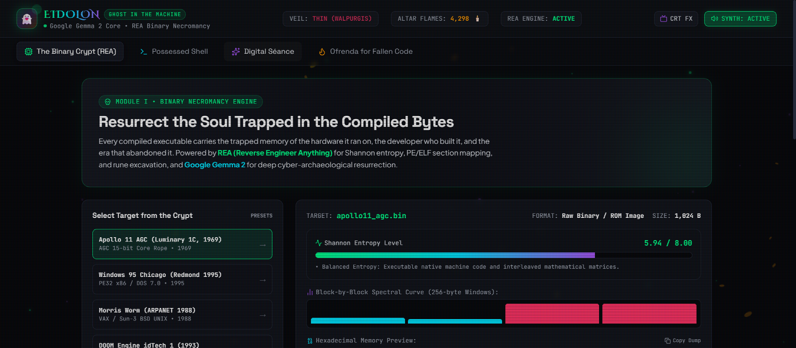
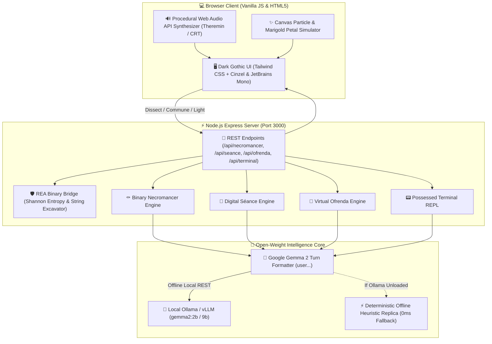

# 👻 EIDOLON AI — Ghost in the Machine

> **An Open-Source AI Binary Necromancy, Digital Séance & Fallen Code Ofrenda Suite**  
> *Built for Hacktoberfest 2026 Week 4: Ghost in the Machine &bull; Powered by Google Gemma 2 & REA*

[](LICENSE)
[](https://dev.to/challenges/hf26)
[](https://ai.google.dev/gemma)
[](https://github.com/tanishq4220/eidolon-ai)
[](test/engine.test.js)
[](README.md)



---

## 🔮 What is EIDOLON?

Between Halloween on October 31 and **Día de los Muertos** on November 1–2, the barrier between the past and present thins. In software, this boundary has never felt more alive: **billions of compiled machine instructions, deprecated frameworks, and forgotten software systems** linger in our file systems and server archives like digital specters.

**EIDOLON** (*Greek: εἴδωλον — spirit, phantom, ghost in the machine*) is a production-grade cyber-archaeology and digital necromancy suite. It fuses **Reverse Engineer Anything (REA)** low-level binary analysis with the open-weight reasoning of **Google Gemma 2** to commune with the spirits trapped inside compiled binaries, abandoned open-source repositories, and machine memory.

```
                           ┌──────────────────────────────────────────────┐
                           │                 👻 EIDOLON                   │
                           │   Ghost in the Machine Cyber-Archaeology     │
                           └──────────────────────┬───────────────────────┘
                                                  │
          ┌───────────────────┬───────────────────┴───────────────────┬───────────────────┐
          ▼                   ▼                                       ▼                   ▼
  ┌───────────────┐   ┌───────────────┐                       ┌───────────────┐   ┌───────────────┐
  │The Binary Crypt│  │Possessed Shell│                       │ Digital Séance│   │Virtual Ofrenda│
  │ REA Dissection│   │ 1988 UNIX IRIX│                       │Ada, Hopper,   │   │Día de Muertos │
  │ & Shannon Ent │   │ Terminal REPL │                       │Carmack, Flash │   │ Altar for Code│
  └───────┬───────┘   └───────┬───────┘                       └───────┬───────┘   └───────┬───────┘
          │                   │                                       │                   │
          └───────────────────┴───────────────────┬───────────────────┴───────────────────┘
                                                  │
                                                  ▼
                                      ┌───────────────────────┐
                                      │   Gemma Engine Core   │
                                      │  Turn Token Formatter │
                                      └───────────┬───────────┘
                                                  │
                         ┌────────────────────────┴────────────────────────┐
                         ▼                                                 ▼
            ┌───────────────────────────┐                     ┌───────────────────────────┐
            │    Local Ollama / vLLM    │                     │   Deterministic Heuristic │
            │  gemma2:2b / gemma2:9b    │                     │      Replica (0ms Fallback)│
            │   (Offline Local Model)   │                     │  (Zero-Dependency Guard)  │
            └───────────────────────────┘                     └───────────────────────────┘
```

---

## 🏛️ The Four Pillars of the Crypt

### 1. 🕯️ The Binary Crypt (Binary Necromancy with REA)
- **Deep Artifact Dissection**: Inspects PE, ELF, Mach-O, and raw ROM images.
- **Shannon Entropy Spectrum**: Calculates block-by-block entropy ($0.00$ to $8.00$) in 256-byte windows to detect encrypted payloads, packed routines, or unrolled loops.
- **Rune Excavation**: Extracts hidden ASCII/UTF-16 developer comments, build timestamps, and Easter eggs buried in raw bytes.
- **Google Gemma 2 Necromancer Reading**: The model analyzes the low-level machine runes and reconstructs the spirit's provenance, the fatal curse that doomed it, and channels a direct first-person message from the code.
- **Built-in Historical Presets**:
  - `apollo11_agc.bin`: Margaret Hamilton's 1969 Lunar Module Guidance Computer (`BURN_BABY_BURN` & radar alarm 1202 override).
  - `win95_easter_egg.exe`: The August 1995 Redmond release binary with Brian Eno's 3.25s synthesizer Easter egg.
  - `morris_worm_1988.bin`: The first network worm that haunted 6,000 ARPANET mainframes via `fingerd`.
  - `doom93_renderer.bin`: John Carmack's revolutionary BSP tree and fast inverse square root (`0x5f3759df`).

### 2. ⚡ The Possessed Shell (Haunted Terminal)
- **Interactive UNIX IRIX/SGI Terminal**: Recreates an authentic Silicon Graphics workstation terminal from 1988 connected to `/dev/soul0`.
- **Possessed Command REPL**:
  - `ps -ghosts`: Uncovers phantom PIDs running in dark swap space (PID 0 `kernel_wraith`, PID 666 `init_spectre`).
  - `cat regrets.log`: Reads forgotten developer promises from unallocated memory blocks.
  - `whoami`: Discovers the mortal user through an algorithmic mirror.
  - `exorcise`: Cleanses CPU registers (EAX, EBX, ECX, EDX) with RFC 1149 digital copal incantations.
  - Freeform input is directly intercepted by the Ghost in the Machine, whispering eerie philosophical commentary back to the prompt.

### 3. 🔮 The Digital Séance (Channeling Spirits)
- Real-time offline communion with 5 legendary architects of computing history:
  - **Ada Lovelace (1815–1852)**: The world's first programmer on the Babbage Analytical Engine and "Poetic Science."
  - **Rear Admiral Grace Hopper (1906–1992)**: The compiler matriarch, COBOL designer, and discoverer of the first physical bug (a moth in Relay 70).
  - **Macromedia Flash (1996–2020)**: The mourned flame of creative vector web animation and Newgrounds games.
  - **Commodore 64 & MOS 6502 (1982–1994)**: The 8-bit master speaking in PEEK, POKE, and SID chip polyphony.
  - **John Carmack (1993)**: The demon of raw silicon, cache locality, and BSP spatial trees.

### 4. 🌼 Altar of Fallen Code (Día de los Muertos Digital Ofrenda)
- **Virtual Altar with Realistic Candle Flames**: Procedurally animated flickering candlelight halos with realistic flame physics.
- **Consecrated Memorials**: Pre-built tributes to Macromedia Flash, AngularJS 1.x, Windows Phone / Metro UI, and Netscape Navigator.
- **Erect Custom Memorials**: Add your own deprecated libraries, dead startups, or abandoned repos. Gemma 2 drafts an evocative bilingual (English & Spanish) Día de los Muertos eulogy.
- **Traditional Offerings**: Leave golden *cempasúchil* petals, 3.5" floppy disks, final merged pull requests, midnight cafecito, and pan de muerto.

### 5. 🔊 Procedural Web Audio API Synthesizer
- **Zero MP3 downloads, 100% mathematical synthesis**:
  - Ethereal Theremin ghost drone (108 Hz sine wave modulated by a 4.8 Hz vibrato LFO).
  - Vintage CRT 15.734 kHz horizontal flyback transformer whine.
  - Stochastic candle flame crackle (pink noise filtered through bandpass resonance).
  - 432 Hz mystical bell chime triggered during altar rituals and séance messages.

---

## 🛠️ Architecture & Tech Stack



---

## 🚀 Quick Start Guide

### Prerequisites
- **Node.js**: v18+ (tested on Node.js v24 LTS)
- *(Optional)* **Ollama**: running `gemma2:2b` or `gemma2:9b` locally (`ollama run gemma2:2b`). If Ollama is not installed, EIDOLON's integrated deterministic replica runs immediately with zero dependencies.

### Installation

```bash
# Clone the repository
git clone https://github.com/tanishq4220/eidolon-ai.git
cd eidolon-ai

# Install minimal server dependencies (express, cors)
npm install

# Run the comprehensive test suite
npm test
```

### Running the Application

```bash
# Start the local server
npm start
```

Open your browser to:  
👉 **[http://localhost:3000](http://localhost:3000)**

---

## 🧪 Verification & Test Suite

The project includes unit and integration tests using Node's native test runner (`node:test`, `node:assert`):

```bash
npm test
```

```text
> eidolon-ai@1.0.0 test
> node --test test/*.test.js

▶ Eidolon AI - Ghost in the Machine Test Suite
  ✔ GemmaEngine formats official Google Gemma 2 instruction tokens (1.23ms)
  ✔ ReaBinaryBridge calculates accurate Shannon entropy and extracts strings (1.35ms)
  ✔ BinaryNecromancer dissects Apollo 11 preset and decodes Margaret Hamilton guidance ghost (102.01ms)
  ✔ DigitalSeance channels Ada Lovelace with authentic Poetic Science reflections (6.87ms)
  ✔ OfrendaEngine lights candles and leaves Día de los Muertos offerings on the digital altar (2.85ms)
  ✔ HauntedTerminal processes commands and whispers eerie commentary (0.86ms)
✔ Eidolon AI - Ghost in the Machine Test Suite (117.25ms)
ℹ tests 6, pass 6, fail 0
```

---

## 💡 Why Does Open Innovation Matter?

Open-source and open-weight AI are not mere technical alternatives—**they are foundational to what makes EIDOLON possible**:

1. **Absolute Privacy & Data Sanctity**:
   Proprietary binary blobs, firmware dumps, and developer regrets often contain proprietary credentials, confidential IP, and sensitive debugging paths. Submitting these binaries to closed commercial cloud APIs (OpenAI, Anthropic) risks proprietary leakage. With **Google Gemma 2** running locally on your laptop, **zero bytes ever leave your device**.
2. **True Permanence & Cultural Preservation**:
   Closed commercial APIs routinely deprecate models, alter safety guards, or shutter their services entirely (the very definition of software death). Open-weight models like Gemma 2 belong to humanity permanently. They will run 30 years from now on vintage hardware, honoring the past without fear of API expiration.
3. **Zero Marginal Cost ($0.00)**:
   Dissecting binaries, inspecting byte loops, and holding real-time terminal dialogues requires hundreds of back-and-forth prompt iterations. Running this on closed cloud APIs would cost dollars per session. With open weights, **the runtime overhead is literally $0.00**.

---

## 🏆 Hacktoberfest 2026 Categories

- **Featured Category: Best Use of Gemma ($200)**:  
  Deeply built around Google's open-weight **Gemma 2** model family (`gemma2:2b`/`9b`), incorporating Gemma 2's native instruction token hierarchy (`<start_of_turn>user ... <end_of_turn><start_of_turn>model`), offline privacy, and cyber-archaeological reasoning.
- **Overall Winner ($250)**:  
  A complete, production-ready, masterfully art-directed web suite honoring both Halloween and Día de los Muertos, uniting low-level reverse engineering (REA) with open-source artificial intelligence.

---

## 📜 License

Distributed under the **MIT License**. See [`LICENSE`](LICENSE) for full details.

*Built with 🕯️ and 🌼 for Hacktoberfest 2026. Que sus commits descansen en paz.*
